# **Microsoft Purview: Gobernanza, Seguridad y Cumplimiento Unificado de Datos**

## **Guía Maestra para Presentación Corporativa (Slide-by-Slide Master Blueprint)**

### Microsoft Purview: Seguridad, Gobernanza y Cumplimiento de Datos en la Era de la IA  

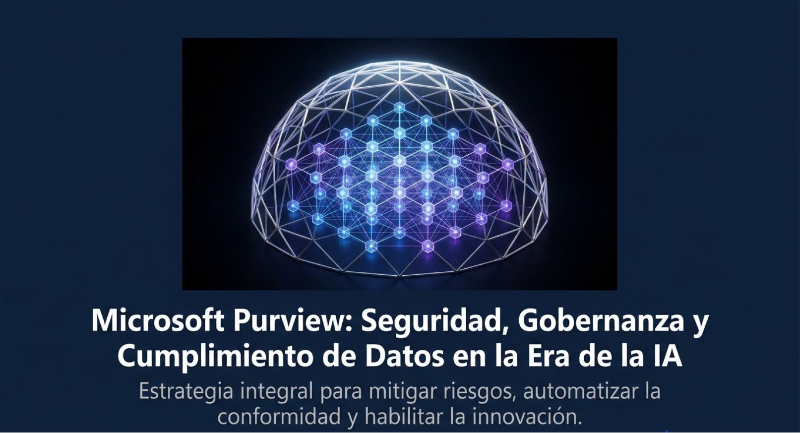
* "Bienvenidos a la presentación sobre Microsoft Purview. En esta sesión analizaremos cómo el patrimonio de datos de nuestra organización, expuesto a una dispersión masiva y acelerado por la adopción de herramientas de Inteligencia Artificial, puede gestionarse mediante una plataforma única.1 Veremos cómo Purview unifica lo que tradicionalmente funcionaba en silos: la seguridad del dato, la gobernanza corporativa y el cumplimiento normativo legal.1 El objetivo de hoy es entender la arquitectura de esta solución, sus ventajas técnicas y cómo aplicarla en escenarios reales del mercado.3"

### **El Desafío de los Datos Modernos**
* **2. La Crisis de Visibilidad en el Patrimonio de Datos** 
  
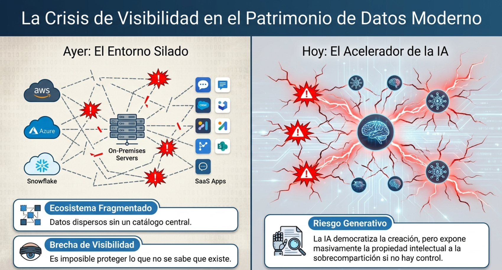

  * *"El crecimiento exponencial de la información ha creado un panorama fragmentado.1 La TI híbrida y multinube ha diluido las fronteras tradicionales de la red de la empresa.4 Además, los equipos de trabajo están utilizando de forma autónoma modelos de IA generativa pública, lo que expone datos corporativos a la fuga de patentes o información privada de clientes.5 El problema crítico de hoy no es solo recopilar datos, sino saber exactamente qué datos tenemos, dónde residen y quién accede a ellos.1"*

* **Contenido Clave:**  
  * **Ecosistema Multinube Fragmentado:** Los datos residen en nubes públicas, sistemas locales, plataformas analíticas como Snowflake y herramientas SaaS.4  
  * **La Brecha de Visibilidad:** Es imposible proteger aquello que no se sabe que existe.1 Las organizaciones desconocen dónde se almacenan sus datos confidenciales.1  
  * **El Acelerador de la IA Generativa:** La proliferación de herramientas de IA incrementa exponencialmente el riesgo de sobrecompartición y fugas de propiedad intelectual.1 

### **La Propuesta de Microsoft Purview**

* **3. Microsoft Purview: Tres Pilares en una Plataforma Única**   

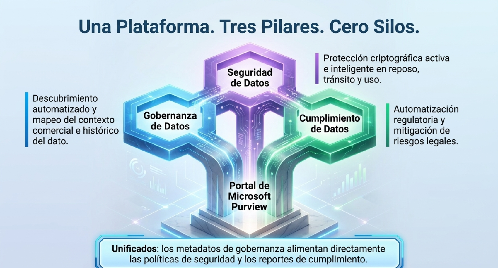

* *"Microsoft Purview consolida bajo una misma interfaz de administración (el Portal unificado de Purview) tres áreas operativas críticas. Anteriormente, los equipos de TI utilizaban una herramienta de catálogo para gobernanza, otra suite para prevención de fugas de datos (DLP) y consultorías externas para auditorías de cumplimiento. Purview integra estas tres disciplinas sobre una base de datos común de metadatos, garantizando que una clasificación de seguridad afecte inmediatamente a las políticas de acceso y a los reportes de cumplimiento normativo.7"*
* **Contenido Clave:**  
  * **Gobernanza de Datos (Data Governance):** Habilita el descubrimiento y el entendimiento del contexto comercial e histórico de los datos.6  
  * **Seguridad de Datos (Data Security):** Protege los datos confidenciales de forma activa en tránsito, en reposo y en uso.  
  * **Cumplimiento de Datos (Data Compliance):** Automatiza el cumplimiento de regulaciones internacionales y minimiza riesgos legales.  

### **Pilar 1 \- Gobernanza Técnica y de Negocio**

* **4. Arquitectura del Gobierno de Datos: Data Map vs. Unified Catalog**
   
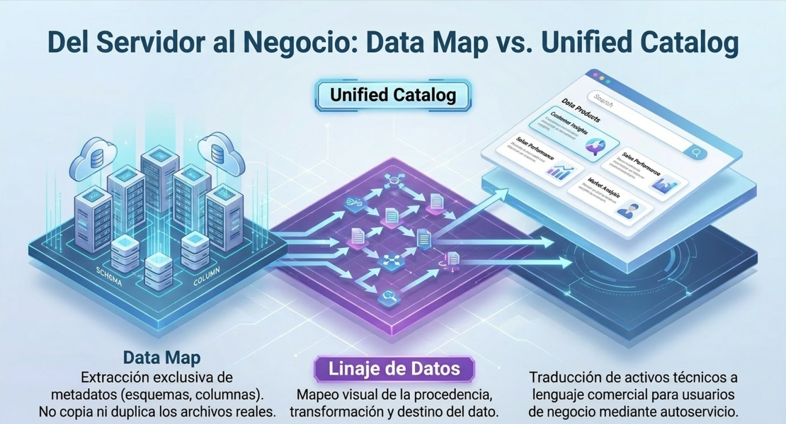
* **Contenido Clave:**  
  * **Data Map (La Capa Física):** Escanea de forma automática los activos de datos corporativos, extrayendo metadatos técnicos y mapeando el linaje de datos sin copiar el contenido real.8  
  * **Unified Catalog (La Capa de Negocio):** Traduce los activos físicos en "Productos de Datos" comprensibles y accesibles para los usuarios empresariales bajo demanda.  
  * **Linaje de Datos (Data Lineage):** Mapeo de extremo a extremo que muestra visualmente de dónde proviene un dato, cómo se ha transformado y dónde se consume.8  
* *"El corazón tecnológico de la gobernanza en Purview reside en la separación de dos capas críticas.8 Por un lado, el Data Map es un motor que actúa a nivel de infraestructura, conectando mediante APIs o redes privadas a nuestros orígenes de datos locales o multinube para recopilar metadatos.8 No duplica nuestros archivos; solo lee esquemas, nombres de columnas e información de linaje.8 Por encima de esto, el Unified Catalog expone esta información técnica en un lenguaje comercial.8 El usuario de finanzas no necesita saber en qué base de datos física reside una columna; solo busca el Producto de Datos de 'Ventas Globales' a través de un buscador de autoservicio guiado por permisos de acceso seguros."*

### **Zoom Técnico \- Elasticidad y Cálculo de Capacidad (CUs)**

* **5. Rendimiento y Costes del Data Map**

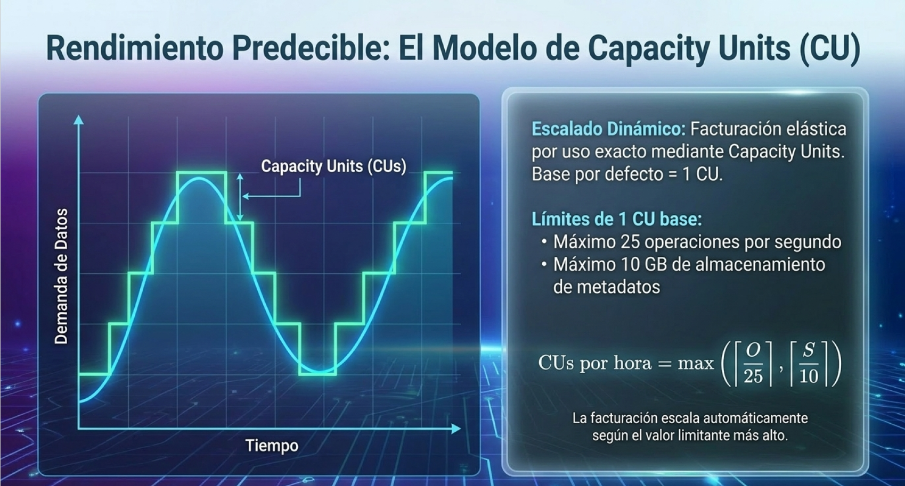
* **Contenido Clave:**  
  * **Escalado Dinámico:** El Data Map se factura mediante un modelo de pago por uso medido en Capacity Units (CU).  
  * **Fórmula de Asignación por Hora:**   $$\text{CUs por hora} = \max\left(\left\lceil \frac{O}{25} \right\rceil, \left\lceil \frac{S}{10} \right\rceil\right)$$
    Donde $O$ es el rendimiento de operaciones por segundo máximo alcanzado en la hora y $S$ es el volumen de metadatos almacenado expresado en gigabytes (GB).9  
  * **Capacidad de una CU Base:** Cada CU provee un rendimiento de hasta $25\text{ operaciones/segundo}$ y un límite de almacenamiento de metadatos de $10\text{ GB}$..9  
* *"El coste del Data Map es altamente predecible y elástico.9 El sistema inicia por defecto con 1 Unidad de Capacidad (CU).9 Si durante procesos de escaneo intensivo o consultas recurrentes del catálogo superamos las 25 operaciones por segundo o acumulamos más de 10 GB de metadatos, Purview escalará elásticamente en incrementos exactos.9 Como vemos en la fórmula, la facturación por hora se determina por el valor limitante más alto entre el volumen de transacciones de metadatos o la capacidad física de almacenamiento que ocupan dichos metadatos.9"*

### ** Pilar 2 \- Seguridad de Datos (Data Security)**

* **6. Seguridad Inteligente: Information Protection y DSPM**

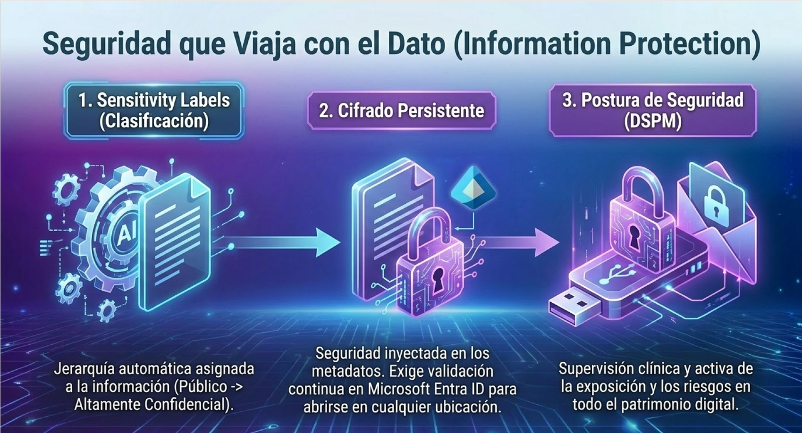
* **Contenido Clave:**  
  * **Sensitivity Labels (Etiquetas de Sensibilidad):** Clasificación jerárquica de la información (p. ej., Público, Confidencial) aplicada automáticamente o sugerida a los usuarios.4  
  * **Cifrado Persistente:** El cifrado de seguridad se inyecta directamente dentro de los metadatos del archivo. La protección viaja con el documento incluso si se comparte fuera de los repositorios corporativos.4  
  * **Data Security Posture Management (DSPM):** Centraliza la visibilidad de los riesgos y evalúa continuamente la exposición de información sensible en entornos tradicionales e híbridos de IA.  
* *"En el área de seguridad de datos, Purview ofrece un cambio de paradigma paradigmático: la protección que viaja con el dato.4 Tradicionalmente, la seguridad dependía de carpetas compartidas con permisos específicos; si alguien descargaba el archivo y lo enviaba por correo, la seguridad se rompía. Con Purview Information Protection, el archivo en sí es cifrado a nivel criptográfico.4 Aunque un empleado lo extraiga de SharePoint y lo guarde en un disco externo, el documento exigirá autenticación contra Microsoft Entra ID antes de poder abrirse o editarse, respetando las políticas originales de la organización.7"*

### **Protección de Datos frente a la IA Generativa**

* **7. Mitigación de Riesgos en la Era de Copilot e IA de Terceros**

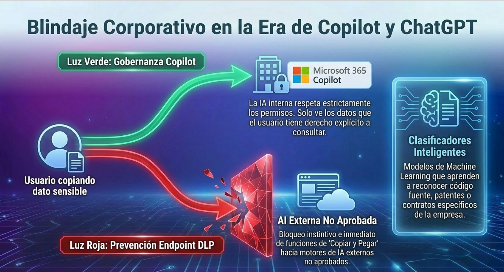
* **Contenido Clave:**  
  * **Control de Fugas de Información en IA:** Purview evita de forma proactiva que información clasificada como confidencial sea copiada o expuesta en motores de IA generativa públicos de terceros (como ChatGPT web).  
  * **Gobernanza de Datos para Copilot:** Garantiza que los modelos de IA corporativos (como Microsoft 365 Copilot) solo tengan acceso a datos que el usuario solicitante tiene autorización explícita para ver, evitando la sobrecompartición accidental.  
  * **Clasificadores Inteligentes Entrenables:** El motor de IA de Purview aprende de manera autónoma los patrones específicos de contratos, patentes o códigos de la organización.7  
* *"Uno de los mayores temores de los directores de seguridad de la información (CISOs) hoy en día es que los empleados peguen código fuente propietario, planes financieros o información de clientes en herramientas de IA externas para resumir o traducir textos. Con Purview, podemos configurar políticas de Endpoint DLP (Prevención de pérdida de datos en el dispositivo final). Si un usuario intenta copiar texto de un documento confidencial y pegarlo en ChatGPT, el sistema bloquea la acción al instante y emite una alerta de riesgo al centro de seguridad."*

### **Pilar 3 \- Cumplimiento y Gestión del Riesgo**

* **8. Minimización de Riesgos Regulatorios y Compliance Manager**

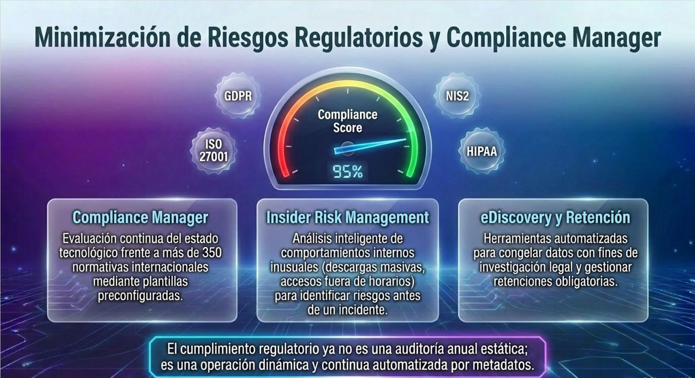
* **Contenido Clave:**  
  * **Compliance Manager:** Evaluación continua del estado tecnológico frente a más de 350 normativas, como GDPR, ISO 27001, NIS2, HIPAA y la nueva EU AI Act.4  
  * **Insider Risk Management (Riesgos Internos):** Análisis inteligente de comportamientos internos inusuales (descargas masivas de archivos, accesos fuera de horarios o intentos de saltar controles de acceso).4  
  * **eDiscovery y Retención Automatizada:** Herramientas automatizadas para congelar datos con fines de investigación legal y gestionar retenciones obligatorias de registros corporativos.7  
* *"El cumplimiento regulatorio ya no es un proyecto estático de auditoría anual; es una operación continua.4 Purview Compliance Manager nos proporciona plantillas preconfiguradas que mapean los requisitos legales en acciones de control técnico automatizadas.4 El sistema analiza de manera dinámica nuestra configuración y nos dice exactamente qué hacer para mantener el cumplimiento.2 Asimismo, Purview Insider Risk analiza comportamientos sospechosos a nivel interno de la red, permitiéndonos identificar riesgos antes de que se materialice un incidente grave o fuga maliciosa.4"*

### **El Caso de Negocio: Retorno de Inversión (ROI)**

* **9 Retorno de Inversión y Eficiencia de Microsoft Purview**

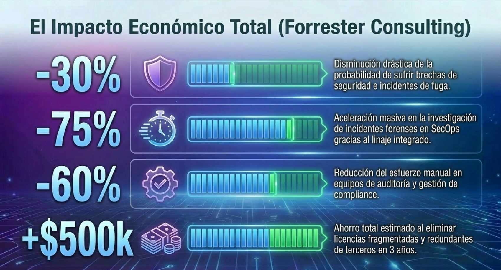
* **Contenido Clave (Métricas de Impacto de Forrester Consulting):**  
  * **Disminución de Brechas de Seguridad:** Reducción del **30%** en la probabilidad de sufrir incidentes de seguridad y fugas de datos.2  
  * **Ahorro de Tiempo en SecOps:** Reducción del **75%** en el tiempo de investigación de incidentes forenses y riesgos.2  
  * **Aumento de Productividad:** Los equipos de cumplimiento reducen en un **60%** el esfuerzo manual para auditar y gestionar el ciclo de vida de los datos.2  
  * **Eliminación de Costes de Licencias de Terceros:** Ahorros estimados de hasta **$500,000 en tres años** por consolidación de herramientas redundantes de TI.2  
* *"Para justificar la inversión en Microsoft Purview ante la mesa directiva, disponemos de los resultados del estudio de Forrester de Impacto Económico Total.2 No estamos hablando únicamente de mayor seguridad teórica, sino de ahorros tangibles de costes.2 Un equipo de seguridad suele perder horas rastreando de dónde provino un archivo filtrado; Purview reduce ese tiempo de investigación en un 75% gracias al linaje integrado y los logs de auditoría centralizados.2 Además, evitamos la necesidad de comprar tres o cuatro licencias de software independientes de otros proveedores, simplificando drásticamente el coste total de propiedad.2"*

### **Caso de Uso Real 1 \- Firma de Servicios Profesionales**

* **10. Caso de Éxito: Blindaje de Propiedad Intelectual en Servicios Profesionales**

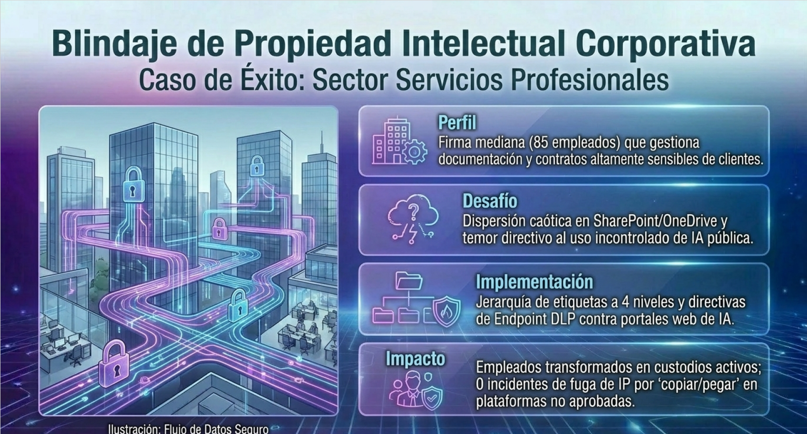
* **Detalles del Caso:**  
  * **Perfil del Cliente:** Firma de servicios profesionales de tamaño mediano (85 empleados) que gestiona documentación de clientes altamente sensible.5  
  * **Desafío:** Archivos confidenciales dispersos sin categorizar en SharePoint, OneDrive y bandejas de correo electrónico. Temor corporativo al uso de herramientas públicas de IA generativa por parte de consultores.5  
  * **Solución Purview Aplicada:** Despliegue estructurado de Purview Information Protection con una política jerárquica de etiquetas en cuatro niveles (Público, Interno, Confidencial y Altamente Confidencial).5 Restricciones estrictas para impedir compartir datos en portales de IA de terceros.  
  * **Resultados:** Clasificación automática de la información, protección continua de la propiedad intelectual de los clientes y un canal controlado y seguro para el uso seguro de tecnologías corporativas.  
* *"Este primer caso real muestra la escalabilidad de Purview.5 En una organización de tamaño mediano, el descontrol documental puede ser crítico.5 Al implementar etiquetas estructuradas de sensibilidad, los propios empleados pasaron a ser custodios activos de la información, guiados por avisos automáticos en Word, Excel y PowerPoint.2 Además, se detuvo por completo el riesgo de que el personal cargara accidentalmente borradores confidenciales de contratos en motores web públicos de inteligencia artificial, evitando incumplimientos por revelación de secretos comerciales."*

### **Caso de Uso Real 2 \- Operador de Infraestructura Crítica**

* **11. Caso de Éxito: Seguridad en un Gran Grupo Portuario**

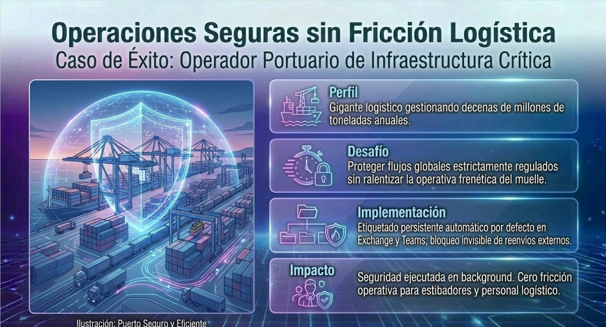
* **Detalles del Caso:**  
  * **Perfil del Cliente:** Uno de los operadores portuarios más grandes del Reino Unido, responsable de la gestión de decenas de millones de toneladas de carga.10  
  * **Desafío:** Necesidad de garantizar la confidencialidad de la información operativa de la cadena de suministro global y el cumplimiento estricto con las regulaciones de infraestructura nacional crítica sin mermar la agilidad de los flujos de trabajo diarios.10  
  * **Solución Purview Aplicada:** Configuración e implementación de una directiva de etiquetado automático persistente y por defecto sobre Exchange, Teams, OneDrive y sitios de SharePoint.10 Bloqueo preventivo de compartición externa en cuentas críticas y automatización del etiquetado de datos estructurados en reposo.10  
  * **Resultados:** Minimización total del riesgo operacional de fuga accidental en comunicaciones críticas, logrando un cumplimiento normativo transparente que no interfiere en las complejas tareas de logística portuaria diarias.10  
* *"En sectores industriales o de infraestructuras críticas, los empleados no pueden lidiar con sistemas lentos que detengan sus operaciones en tiempo real.10 Este caso de éxito con un gran operador portuario demuestra cómo Purview trabaja de forma invisible en segundo plano.10 Mediante políticas de etiquetado por defecto automáticas e inmutabilidad temporal de datos en reposo, el operador portuario pudo blindar la información de su cadena de transporte e impedir el reenvío externo de correos o archivos con datos protegidos sin añadir fricción operativa a los operarios portuarios.10"*

### **Caso de Uso Real 3 \- Sector Salud y Farmacéutico**

* **12. Caso de Éxito: Confidencialidad y Cumplimiento de Datos Médicos**

* **Detalles del Caso:**  
  * **Perfil del Cliente:** Red de hospitales y laboratorios clínicos que manejan datos biométricos, genéticos e historiales de salud altamente regulados.5  
  * **Desafío:** Garantizar la confidencialidad absoluta del paciente para cumplir con el Artículo 9 del GDPR y HIPAA, evitando filtraciones masivas de datos de salud, pero permitiendo que el personal médico acceda a la información necesaria para decisiones clínicas.5  
  * **Solución Purview Aplicada:** Clasificadores preentrenados específicos para el sector salud en el Data Map.7 Implementación de directivas estrictas de retención de registros de salud y auditoría completa de los flujos de acceso de los facultativos médicos.7  
  * **Resultados:** Protección activa de los datos sensibles de salud contra fugas o exfiltración externa de información personal sensible, y facilidad absoluta de cara a la presentación de pruebas documentales para auditorías.4  
* *"Los datos médicos son la información más sensible que puede albergar una corporación.5 Bajo el Artículo 9 del GDPR, las multas por descuidos de datos de salud son devastadoras.5 Purview incluye clasificadores de datos médicos entrenados para reconocer de forma nativa recetas, números de la seguridad social e informes clínicos.7 El sistema identifica estos datos confidenciales allí donde residan y bloquea de manera inmediata cualquier intento de compartirlos por canales inseguros, asegurando que los médicos colaboren a través de entornos cifrados oficiales.4"*

### **Caso de Uso Real 4 \- Sector Industrial y Manufactura**

* **13.Caso de Éxito: Protección de Propiedad Intelectual y Linaje de Datos**

* **Detalles del Caso:**  
  * **Perfil del Cliente:** Empresa multinacional de manufactura avanzada con un ecosistema complejo de patentes, diseños y planos de producción distribuidos globalmente.6  
  * **Desafío:** Riesgo de pérdida o robo de propiedad intelectual (planos de ingeniería CAD, recetas de producción) y falta de visibilidad sobre la calidad y el linaje de los datos analíticos integrados para tomar decisiones comerciales estratégicas.6  
  * **Solución Purview Aplicada:** Integración nativa del catálogo con Microsoft Fabric, bases de datos locales y nubes públicas para extraer metadatos analíticos unificados.6 Monitoreo de linaje de datos de extremo a extremo para garantizar la precisión de los dashboards analíticos corporativos.6  
  * **Resultados:** Protección proactiva de la propiedad intelectual industrial ante accesos no autorizados y garantía de consistencia, origen y calidad en la información analítica de la cadena de producción global.4  
* *"En manufactura avanzada, el valor del negocio reside en los planos de ingeniería y las patentes de productos.11 Con Microsoft Purview, podemos proteger archivos CAD o diseños de manera activa.6 Además, gracias al linaje completo proporcionado por el Data Map, los directores de planta y de finanzas que miran un panel de Power BI en Microsoft Fabric tienen la total certeza y trazabilidad de que los datos de producción provienen de sensores y bases de datos previamente validadas y con altos estándares de calidad de datos.6"*

### **Recomendaciones de Implementación y Hoja de Ruta**

* **14.Buenas Prácticas Técnicas para el Éxito del Proyecto**

* **Contenido Clave:**  
  * **Estructurar Permisos mediante Colecciones:** Delegar responsabilidades organizativas de forma jerárquica a través de Colecciones en lugar de asociar accesos de escaneo a grupos de usuarios de Entra ID.7  
  * **Despliegues en Redes Privadas (Private Endpoints):** Utilizar enlaces de conexión privados para el rastreo y escaneo seguro de orígenes de datos altamente regulados.7  
  * **Gestión de Límites Técnicos (eDiscovery):** Segmentar de forma proactiva las exportaciones legales por periodos de tiempo o custodios para mitigar el límite de rendimiento de 2 TB diarios por inquilino.7  
  * **Control de Costes de Capacidad:** Monitorear de forma activa el uso y escalabilidad de las CUs en el portal de Azure para ajustar los procesos de escaneo recurrentes.7  
* *"Para implementar Microsoft Purview con éxito y optimizar los recursos tecnológicos del proyecto, debemos seguir estas directrices técnicas clave de arquitectura.7 En primer lugar, la gobernanza segura debe delegarse mediante la jerarquía nativa de Colecciones en el Data Map, lo cual garantiza una administración limpia basada en roles RBAC sin sobreexponer credenciales.7 Segundo, si trabajamos en entornos regulados, debemos utilizar Private Endpoints para que el tráfico de metadatos no viaje a través de redes públicas.7 Por último, si nuestro departamento legal requiere realizar procesos masivos de eDiscovery forense, debemos estructurar las búsquedas de forma fraccionada debido a las limitaciones estándar de exportación por inquilino de Microsoft.7"*

### **Conclusiones y Cierre**

* **15. El Futuro de la Gobernanza con Microsoft Purview**

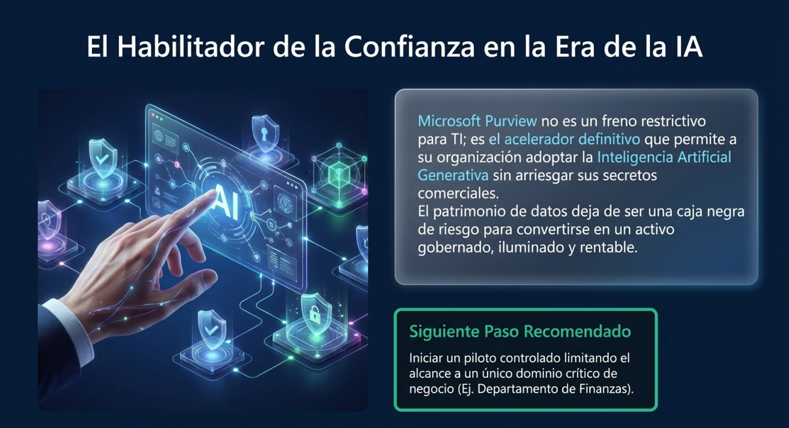
* **Contenido Clave:**  
  * **Convergencia Tecnológica:** Centralizar la gobernanza, seguridad y cumplimiento evita vacíos normativos y optimiza costes operativos.2  
  * **Habilitador del Crecimiento en IA:** Purview no actúa como un freno operativo; es el habilitador necesario para adoptar la Inteligencia Artificial con confianza organizativa total.1  
  * **Llamado a la Acción:** Iniciar con un proyecto piloto escalable enfocado en un Dominio prioritario (p. ej., Finanzas) utilizando el modelo de autoscale dinámico del Data Map.9  
* *"En resumen, Microsoft Purview transforma la seguridad y gobernanza de la información, convirtiendo los procesos restrictivos de seguridad en un motor de resiliencia y confianza.2 Nos da las garantías técnicas para adoptar la IA Generativa sin poner en peligro los secretos de la organización.1 Les invito a dar el primer paso: definir un caso piloto limitado a un dominio estratégico de datos y comenzar a descubrir hoy mismo el valor de un patrimonio de datos verdaderamente unificado y seguro. Muchas gracias."*

#### **Obras citadas**

1. Aprenda acerca de Microsoft Purview | Microsoft Learn, fecha de acceso: junio 3, 2026, [https://learn.microsoft.com/es-es/purview/purview](https://learn.microsoft.com/es-es/purview/purview)  
2. Microsoft Purview delivered 30% reduction in data breach likelihood ..., fecha de acceso: junio 3, 2026, [https://www.microsoft.com/en-us/security/blog/2025/09/23/microsoft-purview-delivered-30-reduction-in-data-breach-likelihood/](https://www.microsoft.com/en-us/security/blog/2025/09/23/microsoft-purview-delivered-30-reduction-in-data-breach-likelihood/)  
3. Empowering Data Governance with Microsoft Purview | by Swetha Mudunuri | Medium, fecha de acceso: junio 3, 2026, [https://iamswetha7.medium.com/empowering-data-governance-with-microsoft-purview-39098d5b34e7](https://iamswetha7.medium.com/empowering-data-governance-with-microsoft-purview-39098d5b34e7)  
4. Microsoft Purview: Data Governance & Compliance \- collana IT, fecha de acceso: junio 3, 2026, [https://www.collana.com/en/microsoft-purview/](https://www.collana.com/en/microsoft-purview/)  
5. The Microsoft 365 Built-In Security Feature: Microsoft Purview | AAG IT Support, fecha de acceso: junio 3, 2026, [https://aag-it.com/the-microsoft-365-built-in-security-feature-microsoft-purview/](https://aag-it.com/the-microsoft-365-built-in-security-feature-microsoft-purview/)  
6. Microsoft Purview Data Map: Everything you need to know \- Plain Concepts, fecha de acceso: junio 3, 2026, [https://www.plainconcepts.com/data-map-purview/](https://www.plainconcepts.com/data-map-purview/)  
7. How Microsoft Purview Works: Architecture, Data Governance, and Best Practices \- Intradyn, fecha de acceso: junio 3, 2026, [https://www.intradyn.com/microsoft-purview-architecture-data-governance/](https://www.intradyn.com/microsoft-purview-architecture-data-governance/)  
8. How to Design Data Access with Microsoft Purview | by René Bremer \- Medium, fecha de acceso: junio 3, 2026, [https://medium.com/data-science-collective/designing-data-access-with-microsoft-purview-c4f920785ef5](https://medium.com/data-science-collective/designing-data-access-with-microsoft-purview-c4f920785ef5)  
9. Learn about Microsoft Purview Data Map, fecha de acceso: junio 3, 2026, [https://learn.microsoft.com/en-us/purview/data-map](https://learn.microsoft.com/en-us/purview/data-map)  
10. Major Port Group Secures Data with Microsoft Purview \- Bridewell, fecha de acceso: junio 3, 2026, [https://www.bridewell.com/insights/case-studies/detail/major-port-group-secures-data-with-microsoft-purview](https://www.bridewell.com/insights/case-studies/detail/major-port-group-secures-data-with-microsoft-purview)  
11. Purview 101: Microsoft's ultimate data governance platform \- Cloud Direct, fecha de acceso: junio 3, 2026, [https://clouddirect.net/learning-hub/purview-101-microsofts-ultimate-data-governance-platform/](https://clouddirect.net/learning-hub/purview-101-microsofts-ultimate-data-governance-platform/)

